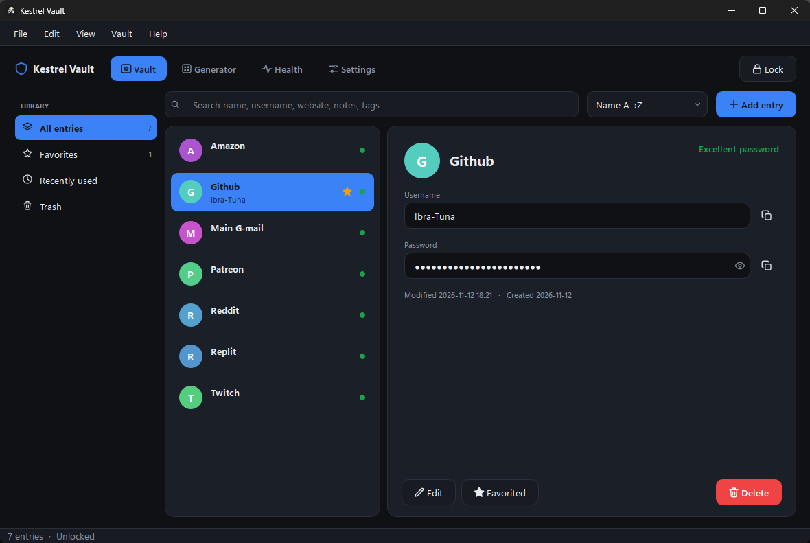

<h1 align="center">Kestrel Vault</h1>

<p align="center">
  <em>A fast, keyboard-first, encrypted password manager for Windows, Linux, and macOS.</em><br>
  No accounts. No sync servers. No telemetry. Just one encrypted file on your disk.
</p>

<p align="center">
  <a href="LICENSE"></a>
  
  
  
  
  <a href="https://github.com/ibra-tuna/Kestrel-Vault/actions"></a>
</p>

<p align="center">
  <a href="#quick-start"><b>Quick start</b></a> ·
  <a href="#features"><b>Features</b></a> ·
  <a href="#security"><b>Security</b></a> ·
  <a href="#build-from-source"><b>Build</b></a>
</p>

<p align="center">
  
</p>

---

## What it is

Kestrel Vault is an **offline** password manager. It stores your logins in a
single file encrypted with **Argon2id** and **Fernet**, opens with your
master password, and never contacts the network. There are no accounts to
create, no subscriptions, and no cloud — just you and a file.

It is a **substantial fork** of [**BNDGG-Vault**](https://github.com/Krahzin/BNDGG-Vault)
by [Krahzin](https://github.com/Krahzin), rewritten with a new interface, a
new vault format, and additional features. See [*Why a fork?*](#why-a-fork).

---

## Quick start

```bash
git clone https://github.com/ibra-tuna/Kestrel-Vault.git
cd Kestrel-Vault
python -m venv .venv
source .venv/bin/activate        # Windows: .venv\Scripts\activate
pip install -r requirements.txt
python -m kestrel_vault
```

That's it. You'll be asked to create a master password on first launch.
**There is no recovery** — lose the password, lose the vault.

> **Windows users in a hurry:** download `KestrelVault-windows.zip` from
> [Releases](https://github.com/ibra-tuna/Kestrel-Vault/releases), unpack,
> and double-click `KestrelVault.exe`.

---

## Features

### Vault
- Encrypted at rest, plaintext only in process memory while unlocked.
- Tag filtering, favourites, sortable list, 30-day Trash, unlimited undo of
  a delete (**Ctrl+Z**).
- Search across name, username, URL, notes, and tags.

### Security
- **Argon2id** with `t=3`, `m=64 MiB`, `p=4` — configurable per vault, saved
  with the file so older vaults keep their parameters.
- **Fernet** (AES-128-CBC + HMAC-SHA256) with a separate canary record — a
  wrong password is distinguishable from a corrupt file.
- **Atomic writes** (`tmp → fsync → os.replace`), so a crash never leaves a
  half-written vault. Previous save kept as `vault.json.bak`.
- **Sensitive clipboard** — copied secrets are auto-cleared after a delay
  and flagged to clipboard managers via OS-specific hints.
- **Auto-lock** on idle, on minimize, or on window blur, each configurable.
- **Persistent lockout** after failed unlock attempts (survives a restart).

### Generator
- Random passwords with adjustable length, character classes, and an
  optional ambiguous-character filter.
- Diceware passphrases from the **EFF Large Wordlist** with configurable
  words, separator, capitalisation, and an optional trailing number.
- Live entropy display in bits.

### 2FA / TOTP
- Paste a bare Base32 secret or an `otpauth://` URI.
- Live codes with a per-period progress bar and a warning colour in the last
  5 seconds.

### Health
- A dedicated **Health** tab scores your vault 0–100 and lists:
  - **Weak** passwords (zxcvbn score ≤ 1)
  - **Reused** passwords (identical fingerprint across entries)
  - **Old** passwords (not changed in over a year)

### Interface
- 12 themes × 10 accent colours, all switchable at runtime.
- Light, dark, and high-contrast options.
- Optional **reduce motion** mode for accessibility.
- Full keyboard navigation — [see shortcuts](#keyboard-shortcuts).

### Interop
- CSV import from **Bitwarden**, **1Password**, **Chrome**, **Edge**, and
  **Firefox**.
- Encrypted backup export/restore with a snapshot of the current vault taken
  before the import.
- One-time copy of an existing BNDGG-Vault data folder on first launch.

---

## Security

Kestrel Vault is designed for **personal use**, not for high-value
credentials held by a team. Here's the honest picture.

### What it protects

| Layer | Choice |
| :--- | :--- |
| Key derivation | **Argon2id** — `t=3`, `m=64 MiB`, `p=4`, 32-byte key, 16-byte salt per vault |
| Encryption | **Fernet** (AES-128-CBC + HMAC-SHA256) over a JSON blob |
| Integrity | HMAC verified before any plaintext is produced; malformed files raise a distinct error |
| Wrong password | Detected via a separate *canary* record, not by catching a decryption failure |
| Disk writes | `tmp → fsync → os.replace`; previous save kept as `vault.json.bak` |
| Brute force | Argon2id + exponential unlock backoff (`lockout.json`) |

### What it does *not* protect

- **An unlocked vault in memory.** Anyone with debugger access to the process
  can read secrets. Use auto-lock and lock-on-blur on shared machines.
- **A compromised OS.** If your machine is already owned, no password manager
  helps.
- **CSV exports.** Imports are plaintext; delete the source file after
  importing.
- **A bad master password.** The KDF slows down guessing; it can't stop a
  weak password. Use the built-in generator.

### Not audited

This project has **not been independently audited**. It uses well-reviewed
libraries (`cryptography`, `argon2-cffi`, `zxcvbn`), but the integration is
not audited. If you need an audited solution, use KeePassXC, Bitwarden, or
1Password.

For vulnerability reports, see [**SECURITY.md**](SECURITY.md).

---

## Why a fork?

This started as a personal project to make BNDGG-Vault fit my workflow. The
core of the codebase was solid, but the interface, file format, and feature
set were limiting. Rather than maintain a shadow fork privately, I rewrote
the parts that needed it and published it here.

| | BNDGG-Vault | Kestrel Vault |
| :--- | :---: | :---: |
| KDF | Argon2id | Argon2id (tuned) |
| Vault schema | v2 | **v3** (migrates v2 on open) |
| UI framework | PySide6 | PySide6 (rewritten) |
| Themes | 1 | **12 × 10 accents** |
| Passphrase generator | — | **EFF diceware** |
| Health report | — | **weak / reused / old** |
| Full `otpauth://` support | partial | **yes** |
| Auto-lock modes | 1 | **3 (idle, blur, minimize)** |
| CSV import | — | **Bitwarden, 1Password, browsers** |
| Encrypted backup restore | — | **with pre-import snapshot** |

The original project remains MIT-licensed and actively developed. If it suits
you better, use it — the fork exists because the two projects have different
priorities, not because one is "wrong".

---

## Where your data lives

| Platform | Folder |
| :--- | :--- |
| **Windows** | `%APPDATA%\KestrelVault\` |
| **Linux**   | `$XDG_DATA_HOME/KestrelVault/` (default `~/.local/share/KestrelVault/`) |
| **macOS**   | `~/.local/share/KestrelVault/` |

| File | Purpose |
| :--- | :--- |
| `vault.json` | The encrypted vault. Back this up. |
| `vault.json.bak` | Automatic copy of the previous save. |
| `vault.v2.bak` | Pre-migration copy, created on first open of a v2 vault. |
| `vault.pre-import-*.json` | Snapshots taken before a backup restore. |
| `settings.json` | UI preferences. **Does not contain secrets.** |
| `lockout.json` | Failed-unlock counter for backoff. |
| `logs/kestrel.log` | Rotating log (≤ ~4 MB total). Never contains plaintext secrets. |
| `cache/` | Small PNGs for the stylesheet. Regenerated as needed. |

---

## Build from source

### Windows `.exe`

From the repo root, in PowerShell:

```powershell
python -m venv .venv
.\.venv\Scripts\python.exe -m pip install -r requirements.txt pyinstaller
.\.venv\Scripts\python.exe -m PyInstaller --noconfirm --clean kestrel_vault.spec
```

Or run **`.\build.ps1`** if you have it checked out — it wraps the same three
commands.

Output: **`dist\KestrelVault.exe`** — a single self-contained file with no
folder beside it. Copy it anywhere and run it.

> The window/exe icon comes from **`app.ico`** in the repo root. Replace that
> file to rebrand.

The CI also builds this artifact on every push to `main` and every tag
matching `v*`. Grab it from **Actions → CI → KestrelVault-windows**.

### From source

```bash
pip install -r requirements.txt
python -m pytest tests -q       # optional, runs the test suite
python -m kestrel_vault
```

---

## Keyboard shortcuts

| Action | Shortcut |
| :--- | :--- |
| New entry | `Ctrl+N` |
| Search vault | `Ctrl+F` |
| Lock vault | `Ctrl+L` |
| Toggle sidebar | `Ctrl+B` |
| Switch to Vault / Generator / Health / Settings | `Ctrl+1` / `2` / `3` / `4` |
| New generated password | `Ctrl+G` |
| Copy password / username / TOTP | `Ctrl+Shift+C` / `U` / `T` |
| Edit selected entry | `Ctrl+E` |
| Move entry to Trash | `Del` |
| Undo last delete | `Ctrl+Z` |
| Quit | `Ctrl+Q` |

---

<details>
<summary><b>Architecture</b> (click to expand)</summary>

<br>

Kestrel Vault separates a **pure-Python core** from a **Qt UI** so the core
can be unit-tested headlessly and reused from a CLI:

```
kestrel_vault/
├── __main__.py       entry point: `python -m kestrel_vault`
├── crypto.py         Argon2id KDF, Fernet, TOTP               (no Qt)
├── storage.py        vault file I/O, atomic writes, lockout   (no Qt)
├── session.py        in-memory vault, debounced saves
├── models.py         Entry model, legacy migration, health    (no Qt)
├── passwords.py      strength estimation, generation, diceware(no Qt)
├── importers.py      CSV import (Bitwarden, 1Password, browsers)
├── services.py       Qt services: settings, theme, clipboard
├── theme.py          theme tokens + stylesheet builder
├── icons.py          inline SVG icon set, tinted per theme
├── style.qss.tpl     Qt stylesheet template ($tokens filled by theme.py)
└── ui/               Qt widgets — the only place that imports PySide6
    ├── main_window.py
    ├── unlock.py
    ├── vault.py
    ├── generator.py
    ├── health.py
    ├── settings_tab.py
    ├── dialogs.py
    └── common.py
```

**The rule:** `crypto`, `storage`, `models`, `passwords`, and `importers` must
not import `PySide6`. The test suite depends on this — it runs the core in a
headless environment with no Qt installed.

</details>

<details>
<summary><b>FAQ</b> (click to expand)</summary>

<br>

**Why not use Bitwarden or KeePassXC?**
Different trade-offs. Kestrel Vault is a single-file, zero-sync, single-user
app with a native UI. If you want hosted sync or a long audit history, use
Bitwarden or KeePassXC — they're excellent and we're not competing.

**Can I sync the vault between machines?**
Not built in. The vault is a single file — sync it yourself with Syncthing,
Dropbox, a Git repo, or a USB drive. Don't sync it while it's open, or you
risk conflicts.

**Does the app phone home?**
No. No telemetry, no update checks, no analytics. The only network use is
the OS opening a URL you click in an entry.

**What if I forget my master password?**
There is no recovery. That's by design — any recovery mechanism would be a
backdoor. Use a long passphrase you can remember.

**Can I migrate from BNDGG-Vault?**
Yes, automatically. See [*Migrating from BNDGG-Vault*](#migrating-from-bndgg-vault).

**Is there a portable mode?**
Not officially. You can set `APPDATA` (Windows) or `XDG_DATA_HOME`
(Linux/macOS) to a folder on the USB drive before launching.

**Why is the release only on Windows?**
The PyInstaller spec is Windows-only. Linux and macOS users can run from
source. Contributions for a macOS `.app` bundle are welcome.

</details>

<details>
<summary><b>Migrating from BNDGG-Vault</b> (click to expand)</summary>

<br>

On first launch, if a `BNDGGVault` data folder exists and no `KestrelVault`
folder does, the app **copies** (never moves) `vault.json` and `settings.json`
into the new folder. The old folder is left untouched.

The old vault then opens as-is and is migrated to schema v3 on first unlock.
The pre-migration file is kept as `vault.v2.bak` in case you need to roll
back to BNDGG-Vault.

If you'd rather do it manually: copy `vault.json` from
`%APPDATA%\BNDGGVault\` (Windows) or `~/.local/share/BNDGGVault/`
(Linux/macOS) into the corresponding `KestrelVault` folder and launch the app.

</details>

<details>
<summary><b>Contributing</b> (click to expand)</summary>

<br>

1. Fork, then branch: `git checkout -b feature/my-thing`.
2. Keep `python -m pytest tests -q` green.
3. Respect the architecture rule: **no `import PySide6`** in `crypto.py`,
   `storage.py`, `models.py`, `passwords.py`, or `importers.py`.
4. Match the existing style.
5. Open a pull request describing what changed and why.

For security issues, **do not open a public issue** — see
[SECURITY.md](SECURITY.md).

</details>

---

## License

[MIT](LICENSE). This project is a fork of
[**BNDGG-Vault**](https://github.com/Krahzin/BNDGG-Vault), also MIT-licensed.
See [NOTICE](NOTICE) for the original authorship and a list of changes.

## Credits

- **Original project:** [BNDGG-Vault](https://github.com/Krahzin/BNDGG-Vault)
  by [Krahzin](https://github.com/Krahzin).
- **Fork maintainer:** Ibrahim Al Assaad ([@ibra-tuna](https://github.com/ibra-tuna)).
- **Libraries:** [PySide6](https://www.qt.io/qt-for-python) (LGPLv3),
  [cryptography](https://cryptography.io),
  [argon2-cffi](https://github.com/hynek/argon2-cffi),
  [zxcvbn](https://github.com/dropbox/zxcvbn),
  [diceware](https://github.com/ulif/diceware).
- **Wordlist:** [EFF Large Wordlist](https://www.eff.org/deeplinks/2016/07/new-wordlists-random-passphrases) (CC-BY 3.0).
